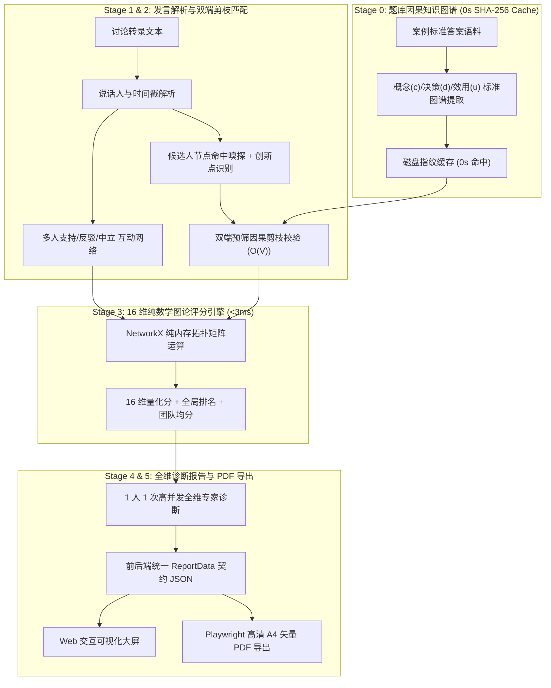

# 🌟 TalentGraph

<div align="center">

**基于 16 维因果影响图谱与多人博弈拓扑网络的无领导小组讨论（LGD）量化评估系统**

[](https://www.python.org/)
[](https://fastapi.tiangolo.com/)
[]()
[]()
[](LICENSE)

[在线体验](#-快速开始) • [核心架构](#-系统架构演进) • [16维能力图谱](#-16-维量化能力图谱矩阵) • [API 文档](#-api-与-websocket-接口) • [CLI 终端指令](#-cli-终端命令)

</div>

---

## 📖 项目简介

**TalentGraph** 是面向**无领导小组讨论（Leaderless Group Discussion, LGD）**招聘与选拔场景研发的新一代全链路 AI 人才量化评估系统。

系统通过将讨论转录文稿与案例标准答案转化为**因果影响图谱（Causal Influence Graph）**与**多人博弈互动拓扑网络（Interaction Topology）**，彻底打破传统评估对 GPU 显卡、数百次大模型碎片化调用的算力枷锁，实现**纯 CPU 极速部署、微秒级纯数学图论打分、1 人 1 次全维专家画像诊断**与**高清矢量 A4 PDF 报告一键导出**。

---

## ⚡ 性能与架构演进对比

| 评测维度 | 传统评测方案 | TalentGraph 全新架构 | 核心优势 |
| :--- | :--- | :--- | :--- |
| **算力与运行环境** | 强依赖 24G+ GPU (CUDA / PyTorch / Transformers) | **纯 CPU 极速架构** (轻量级/无重量级 AI 框架) | 零 GPU 成本，通用服务器与个人电脑即可顺畅运行 |
| **总评测耗时** | **53 分钟** (全员 12 人) | **60 ~ 90 秒** | 提速 **30~50 倍** |
| **标准图谱提取** | 每次评测重复分段提取与合并 (~30s) | **Stage 0 SHA256 图谱指纹缓存** | 二次运行 **0 秒命中** |
| **因果边校验复杂度**| $O(V^2)$ 笛卡尔积暴力全量校验，调用 121+ 次 | **双端命中预筛剪枝**（仅校验两端皆提及的边） | 剔除 **90%+** 无效 LLM 请求 |
| **16 维评分计算** | 评分器内混杂正则/写盘/LLM (333~572s) | **纯内存图论与网络拓扑矩阵运算** | 全员 16 维计算耗时 **< 3ms** (提速 10 万倍) |
| **诊断评语生成** | 16 维 × 12 人 = 192 次碎片化请求 | **1 人 1 次高并发全维专家诊断** (全员仅 12 次) | Token 消耗降低 **80%+**，评语连贯完整 |
| **交付形态** | 碎片脚本 + 本地文件 | **Monorepo 全栈闭环** (CLI + FastAPI + WebSocket + Dashboard + PDF) | 开箱即用，支持一键集成与微服务部署 |

---

## 🏗️ 系统架构演进与流水线



---

## 📊 16 维量化能力图谱矩阵

TalentGraph 将经典的无领导小组讨论评价维度映射为严谨的图论数学指标：

| 模块维度 | 维度编号与名称 | 图论量化与数学评估逻辑 |
| :--- | :--- | :--- |
| **D1 逻辑与思考** | `1_1 逻辑思维` | 演绎推理链 ($c\to d, d\to u$) + 归纳推理 ($c\to c$) + 多跳深度因果链加权 |
| | `1_2 抽象归纳` | 概念节点覆盖率 + 单发言段内多源概念综合提炼频率 |
| | `1_3 系统思维` | 宏观效用($u$)、中观决策($d$)、微观事实($c$) 金字塔乘积 $(1+u)\times d\times c$ + 子图密度 |
| **D2 目标与执行** | `2_1 目标拆解` | 效用目标节点覆盖度 + 决策方案到目标的可达因果路径数 |
| | `2_2 信息收集` | 客观事实概念 $c$ 引用频次 + 全场时间跨度加权 |
| | `2_3 方案影响预判` | 决策方案 $d$ 在候选人图谱中的出度总和与波及影响面 |
| **D3 创新与发散** | `3_1 创造性` | 突破标准题库的新颖见解（`novel_nodes`）识别数量与独立加权 |
| | `3_2 联想能力` | 提及节点在标准图谱中的最短跳数与跨领域跨度加权 ($\ge 3$ 跳) |
| | `3_3 方案可行性` | 决策节点具备客观事实支撑（$c\to d$）与资源约束闭环的比例 |
| **D4 影响力激发** | `4 思维激发` | 在多人互动网络中被他人回应次数 + 首次提出节点被后续成员跟进次数 |
| **D5 团队与协同** | `5_1 开放性` | 主动发起 `support` / `neutral` 承接频次与覆盖成员广度 |
| | `5_2 冲突消解` | 调解支持 + 建设性反驳 + 提出折中决策推进共识的能力 |
| | `5_3 协作中心性` | 加权入度中心性（支持+1 / 反对-0.5）+ 团队中介中心性（Betweenness） |
| **D6 效率与收敛** | `6_1 聚焦性` | 发言语义向量与讨论核心主题的余弦相似度均值 |
| | `6_2 时间把控` | 讨论前、中、后三阶段发言参与均衡度 + 单次发言适度性 |
| | `6_3 结论收敛性` | 讨论后 40% 冲刺决议期产出的决策节点数 + 推动共识收敛次数 |

---

## 🚀 快速开始

### 1. 环境准备与安装

推荐使用 Python 3.10+ 环境：

```bash
# 克隆仓库
git clone https://github.com/your-org/talent-graph.git
cd talent-graph

# 安装依赖 (建议在虚拟环境中运行)
cd talent_graph/backend
pip install -e ".[dev]"
```

### 2. 配置环境变量

复制配置文件模版并填入您的 LLM API Key（支持 DeepSeek / 通义千问 Qwen / OpenAI）：

```bash
cp .env.example .env
```

`.env` 核心配置项示例：
```ini
# LLM 提供商: deepseek | qwen | openai | mock
LLM_PROVIDER=deepseek

# DeepSeek 密钥与端点
DEEPSEEK_API_KEY=sk-your-deepseek-key
DEEPSEEK_BASE_URL=https://api.deepseek.com/v1
DEEPSEEK_MODEL=deepseek-chat

# 阿里通义千问配置 (可选)
# DASHSCOPE_API_KEY=sk-your-dashscope-key
# QWEN_MODEL_NAME=qwen-plus

# 并发与超时
LLM_MAX_CONCURRENCY=20
LLM_TIMEOUT=60.0

# 纯 CPU 向量引擎
EMBEDDING_PROVIDER=onnx
EMBEDDING_MODEL=BAAI/bge-small-zh-v1.5
```

### 3. 运行自动化测试套件

```bash
pytest tests/ -v
```
*(全部 32 个单元测试与微秒级基准测试将在 2~3 秒内完成验证)*

---

## 🛠️ CLI 终端命令

TalentGraph 提供了开箱即用的统一 CLI 终端工具：

```bash
# 1. 核心组件基准测速 (测试纯 CPU 向量引擎与 16 维评分器微秒级性能)
python talent_graph/cli.py benchmark

# 2. 预热标准题库图谱 (提取并存入 SHA256 缓存)
python talent_graph/cli.py prepare --corpus data/input/corpus/corpus.txt

# 3. 执行端到端评测流水线，并在终端输出排行榜大盘
python talent_graph/cli.py evaluate \
  --corpus data/input/corpus/corpus.txt \
  --group data/input/group_corpus/271_1.txt \
  --title "新能源战略研讨会"

# 4. 执行评测并直接导出每位候选人的高清 PDF 报告
python talent_graph/cli.py evaluate \
  --corpus data/input/corpus/corpus.txt \
  --group data/input/group_corpus/271_1.txt \
  --export-pdf

# 5. 一键启动 Web 可视化大屏与 API 后端服务
python talent_graph/cli.py server --port 8000
```

---

## 🌐 API 与 WebSocket 接口

系统自带基于 FastAPI 构建的高性能异步 REST API 与实时进度广播：

* **API 文档与 Swagger UI**：`http://localhost:8000/docs`
* **交互式数据可视化看板**：`http://localhost:8000/`

### 核心 REST API 路由

| 方法 | 接口路径 | 描述 |
| :--- | :--- | :--- |
| `GET` | `/health` | 服务健康检查与引擎状态探针 |
| `POST`| `/api/v1/assessment/submit` | 提交评测任务（支持标准语料与转录文稿） |
| `GET` | `/api/v1/assessment/{task_id}` | 查询任务处理状态与进度百分比 |
| `GET` | `/api/v1/assessment/{task_id}/data` | 获取前后端统一契约的完整 `ReportData` JSON |
| `GET` | `/api/v1/assessment/{task_id}/pdf` | 导出并下载指定候选人的高清 A4 矢量 PDF 报告 |
| `WS`  | `/ws/assessment/{task_id}` | WebSocket 实时推送评测进度 (0% ~ 100%) |

---

## 📁 模块与目录架构

```text
talent_graph/
├── cli.py                         # 统一 Typer CLI 终端入口
├── README.md                      # 项目说明文档
│
├── data/                          # 业务数据根目录 (与代码解耦，支持挂载)
│   ├── cache/corpus/              # 案例参考答案 SHA256 提取缓存 (0s 命中)
│   ├── input/                     # 原始题库语料与讨论转录文稿
│   └── projects/{task_id}/        # 按会议场次独立隔离归档
│       ├── report.json            # 前后端统一的自包含评测报告契约
│       ├── graphs/                # 该场会议的拓扑图谱数据
│       └── pdf_reports/           # 导出的候选人 A4 PDF 报告
│
├── frontend/dist/                 # 前端可视化大屏与报告母版
│   ├── index.html                 # 交互式数据看板大屏 (ECharts + Tailwind)
│   └── report-print.html          # A4 矢量 PDF 打印母版页
│
└── backend/                       # 纯净无状态后端引擎
    ├── pyproject.toml             # 依赖管理与项目元数据
    ├── server.py                  # FastAPI Web 服务与 WebSocket 启动入口
    ├── configs/settings.py        # 全局配置中心 (Pydantic BaseSettings)
    ├── src/
    │   ├── api/                   # RESTful 接口与 WebSocket 进度广播
    │   ├── core/                  # 纯 CPU 向量计算、异步 LLM 客户端与日志
    │   ├── knowledge/             # Stage 0: 题库标准图谱提取与 0 秒缓存
    │   ├── models/                # Pydantic V2 领域数据模型 (Graph/Discussion/Score/Report)
    │   ├── pipeline/              # Stage 1&2: 发言解析、互动网提取与双端因果剪枝
    │   ├── scoring/               # Stage 3: 16 维纯数学图论评分引擎 (<3ms)
    │   └── reporting/             # Stage 4&5: 1人1次全维诊断与 Playwright PDF 导出
    └── tests/                     # 自动化测试套件 (32 个测试)
```

---

## 📄 开源许可证

本项目基于 [MIT License](LICENSE) 开源。
