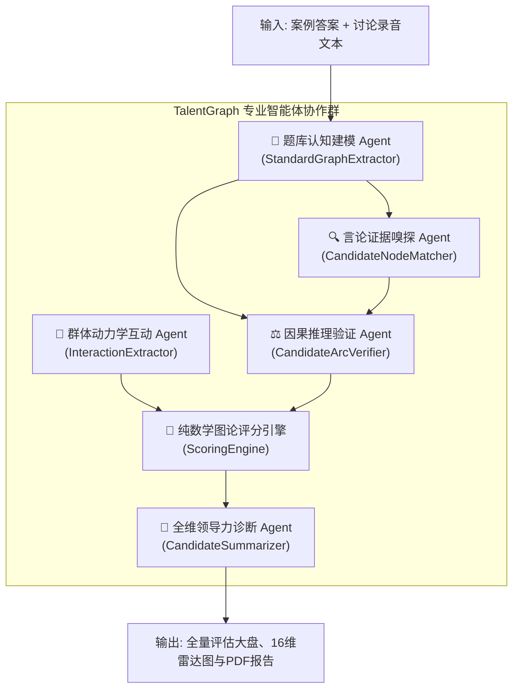
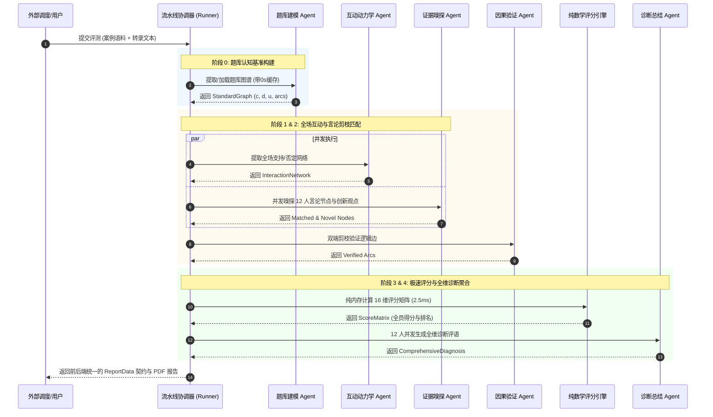

# TalentGraph 多智能体系统架构与 Agent 设计范式指南

> **文档定位**：本文档深入阐述了 `TalentGraph` 系统的 Agent 架构定位，详细解析了系统内各个专业子智能体（Sub-Agents）的分工与协作机制，并对比了工作流型 Agent（Flow Engineering）与自由探索型 Agent（ReAct）的设计哲学差异。

---

## 目录
1. [系统定位：工作流编排型多智能体系统](#一系统定位工作流编排型多智能体系统)
2. [六大核心子智能体（Sub-Agents）角色分工](#二六大核心子智能体sub-agents角色分工)
3. [多智能体协作时序与数据流转](#三多智能体协作时序与数据流转)
4. [Agent 范式对比：工作流智能体 vs 自由探索智能体](#四agent-范式对比工作流智能体-vs-自由探索智能体)
5. [总结与行业理论参考](#五总结与行业理论参考)

---

## 一、 系统定位：工作流编排型多智能体系统

`TalentGraph` 是一个**工作流编排型多智能体系统（Workflow-Orchestrated Multi-Agent System）**，更准确地定义为：**“基于因果影响图谱的结构化认知评估智能体系统（Cognitive Graph Assessment Agent）”**。

在无领导小组讨论（LGD）这一高阶认知与群体行为评估场景中，单次 LLM 无法处理长达数万字的复杂多人多轮对话，且传统的单一提示词容易产生“幻觉”和“评分漂移”。`TalentGraph` 将评估这一复杂任务解耦为**多个垂直专业子智能体**，每个智能体具备明确的领域角色（Persona）、输入输出结构契约（Pydantic Schema）与工具集。

---

## 二、 六大核心子智能体（Sub-Agents）角色分工

### 1. 🧠 题库认知建模 Agent (`StandardGraphExtractor`)
* **定位**：专家认知与标准题库建模师。
* **职责**：深入研读专家案例材料与标准参考答案，自主提取出：
  * **概念事实节点 ($c$)**：行业背景、客观约束、外部信息；
  * **决策行动节点 ($d$)**：解决举措、管理动作、战略方案；
  * **效用价值节点 ($u$)**：最终目标、衡量标准、商业/社会效益；
  * **逻辑因果边 ($Arc$)**：信息支撑边 ($c \to d$)、因果影响边 ($d \to u$)、状态更新边。
* **特性**：内置 SHA256 指纹感知，支持 0 秒瞬时缓存命中。

### 2. 👥 群体动力学互动 Agent (`InteractionExtractor`)
* **定位**：团队动力学与人际交互分析师。
* **职责**：从全局视角通读全场所有发言，识别候选人之间的言论回应关系：
  * **支持赞同 (Support)**：肯定他人、补充观点、强化提议；
  * **质疑反驳 (Deny)**：指出漏洞、提出相悖方案、纠偏；
  * **中立承接 (Neutral)**：顺应话头继续展开。
* **输出产物**：输出全场互动有向加权邻接矩阵 `InteractionNetwork`。

### 3. 🔍 言论证据嗅探 Agent (`CandidateNodeMatcher`)
* **定位**：言论洞察与发散思维探测器。
* **职责**：针对每位候选人的全量发言进行并发细粒度比对：
  * **标准命中**：判断其言论命中了标准图谱中的哪些节点，记录精确时间戳与原话引述；
  * **创新探测**：主动识别候选人提出的**超出标准题库之外、具有独立商业价值的创新发散观点 (Novel Nodes)**。
* **特性**：配备纯 CPU 句向量余弦相似度引擎作为离线降级兜底。

### 4. ⚖️ 因果推理验证 Agent (`CandidateArcVerifier`)
* **定位**：逻辑推演与手段-目的链核验法官。
* **职责**：验证候选人是否切实表达了节点之间的因果推导关系。
* **核心算法**：**双端命中预筛剪枝（Dual-ended Pruning）**。对于标准因果边 $A \to B$，仅当候选人**既提到了 A 又提到了 B 时**才发起验证，将算法复杂度从 $O(V^2)$ 降低至 $O(V)$，剔除 90%+ 无效请求。

### 5. 📐 纯数学图论评分引擎 (`ScoringEngine`)
* **定位**：确定性量化评估计算工具（Deterministic Quant Evaluator）。
* **职责**：100% 内存纯数学/纯图论计算。基于 NetworkX 图模型，计算 16 维度的因果路径长度、金字塔三层乘积、加权入度中心性、中介中心性等。
* **性能**：全员 12 人 16 维度打分仅需 **2.4 ~ 3.0 毫秒**。

### 6. 📝 全维领导力诊断 Agent (`CandidateSummarizer`)
* **定位**：资深高管测评与领导力发展顾问。
* **职责**：以 1 人 1 次高并发 Prompt 接收候选人的 16 维得分矩阵、全场排名与关键行为佐证，综合撰写：
  * **总体综合评价 (Summary)**
  * **核心竞争优势 (Strengths)**
  * **主要薄弱环节 (Weaknesses)**
  * **针对性成长建议 (Growth Suggestions)**
  * **个性化人才标签 (Talent Tags)**

---

## 三、 多智能体协作时序与数据流转

---

## 四、 Agent 范式对比：工作流智能体 vs 自由探索智能体

在当前大模型前沿体系（如 Anthropic **《Building Effective Agents》**）中，智能体主要分为两类：

| 评估维度 | 自由探索型 Agent (如 ReAct / AutoGPT) | TalentGraph 结构化工作流 Agent |
| :--- | :--- | :--- |
| **工作机制** | 由 LLM 自主决定何时停止、何时调工具，陷入“思考-行动-观察”无界自循环 | **Flow Engineering（工作流工程化）**：严密拓扑流转，每一步输入输出强类型约束 |
| **执行耗时** | 不可预测，容易陷入死循环或重复调用（老系统耗时 53 分钟即此问题） | **严格确定可控（全流程 60~90 秒，评分 2.4ms）** |
| **计算确定性** | 每次打分存在随机浮动与幻觉，不可复现 | 评分阶段交由纯数学图论模型，**100% 确定、高精度且可回归验证** |
| **Token 与成本** | 碎片化 Prompt 频繁调用，Token 开销极大 | **批量并发压缩（Batching & Pruning）**，节省 90%+ 算力成本 |
| **适用场景** | 开放域探索、自主写代码、聊天搜索 | **企业级严谨人才测评、金融风控、医疗诊断等专业生产环境** |

---

## 五、 总结与行业理论参考

> **核心结论**：
> `TalentGraph` 并不是一个松散的自由对话机器人，而是一个**严格工程化的垂直领域多智能体系统（Vertical Multi-Agent System）**。

它完美践行了当前 AI 领域的最优设计哲学：
1. **让 LLM 做它最擅长的事**：深度语义理解、开放式观点发现、因果关系判断与高情商诊断总结；
2. **让数学与图论做它们最擅长的事**：极速矩阵运算、NetworkX 中心性计算、百分制归一化与精确排序；
3. **通过 Pydantic 契约编排协作**：确保系统在企业级高并发场景下兼具 **AI 的深度洞察力** 与 **传统软件的极致速度与稳定性**。
