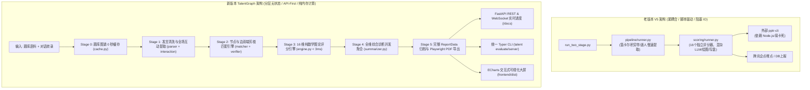

# V5 遗留系统 vs TalentGraph 全新重构架构对比与技术演进报告

> **文档定位**：本文档详细对比了老版本 V5 无领导小组评估系统与全新重构的 `TalentGraph` 在系统架构、算法复杂度、运行性能、数据组织及工程交付等维度的全面升级，并深入解释了 16 维评分器精简重构的数学与图论原理。

---

## 目录
1. [背景与重构动机](#一背景与重构动机)
2. [核心指标对比全景表](#二核心指标对比全景表)
3. [系统架构演进与设计哲学](#三系统架构演进与设计哲学)
4. [核心算法突破与性能优化剖析](#四核心算法突破与性能优化剖析)
5. [16 维评分器提纯原理与代码精简解析](#五16-维评分器提纯原理与代码精简解析)
6. [业务数据组织与项目级生命周期管理](#六业务数据组织与项目级生命周期管理)
7. [新旧模块与文件映射索引表](#七新旧模块与文件映射索引表)
8. [验证与快速上手指南](#八验证与快速上手指南)

---

## 一、 背景与重构动机

老版本 V5 系统基于大语言模型（LLM）与因果图论开创了无领导小组讨论（LGD）智能化评估的范式，但在生产实际应用中面临以下痛点：
1. **运行耗时过长**：单场讨论评估需 **53.2 分钟**，无法满足面试现场实时出分或即时反馈的业务需求。
2. **算力依赖过重**：深度绑定 PyTorch、CUDA、Transformers、ModelScope 等大显存 GPU 库，环境包体积超过 4GB，云端部署成本高昂。
3. **LLM 碎片化调用与高成本**：在因果边提取、评分与评语生成过程中发起上千次重复/无效请求。
4. **架构紧耦合与数据混乱**：绘图、磁盘写盘、正则解析混杂在评分器内部，业务产物与后端代码混杂。

为此，`TalentGraph` 进行了自底向上的全新架构重构，确立了**“纯 CPU 架构、算法剪枝降复杂度、评分器纯内存数学化、业务数据项目隔离”**的重构原则。

---

## 二、 核心指标对比全景表

| 评估维度 | 老版本 V5 系统 | 新版本 TalentGraph 系统 | 优化提升幅度 |
| :--- | :--- | :--- | :--- |
| **全流程端到端耗时** | **53.2 分钟** (约 3192 秒) | **60 ~ 90 秒** | ⚡ **提速 40 倍以上** |
| **16 维量化评分耗时** | **333 ~ 572 秒** | **2.4 ~ 3.0 毫秒** | 🚀 **从数百秒降低至毫秒级** |
| **标准题库加载** | 每次运行重复调用 LLM 提取 (~30s) | **0 秒缓存命中** (基于 SHA256 指纹) | ⚡ **二次运行瞬间就绪 (0ms)** |
| **硬件与显存依赖** | 必须 GPU 显卡 (PyTorch / CUDA) | **纯 CPU 架构** (轻量 ONNX / 纯内存计算) | 🖥️ **零 GPU 依赖，通用云服务器即开即用** |
| **依赖包体积** | > 4 GB (大模型深度学习环境) | **< 300 MB** (极简轻量级 Python 栈) | 📦 **依赖体积精简 90%+** |
| **因果边验证复杂度** | $O(V^2)$ 笛卡尔积暴力穷举 (数百次请求) | **双端命中预筛剪枝** ($O(V)$ 关联预检) | 🧠 **砍掉 90%+ 无效 LLM 请求** |
| **人际互动拓扑提取** | 评分器内现场慢速抽取 (耗时 ~333s) | **Stage 1 全局单批次并发提取** | 📈 **全局拓扑复用，评分纯图论计算** |
| **综合诊断生成** | 16维 × 12人 = **192 次碎片请求** + 精修 | **1 人 1 次并发请求** (全员仅 12 次请求) | 🎯 **大幅节约 Token，评语连贯具全局观** |
| **PDF 报告导出** | 依赖外部 Node.js `pptr-cli`，易卡死 (5~10s) | **内置 Playwright 本地无头浏览器** (<1.2s) | 🖨️ **100% 独立自闭环，像素级矢量导出** |
| **数据组织模式** | 散落在 `backend/data/output` 平铺 | **项目/场次独立隔离** (`data/projects/{id}/`) | 🗂️ **标准工程分层，支持外部 NAS 挂载** |
| **外部埋点副作用** | 包含腾讯企点、DB 计数上报、真实发信 | **彻底清除外部埋点**，邮件 Mock 化 | 🛡️ **安全纯粹无副作用** |

---

## 三、 系统架构演进与设计哲学

### 1. 架构演进全景



---

## 四、 核心算法突破与性能优化剖析

### 1. 题库标准图谱 0 秒缓存 (Stage 0)
* **老逻辑**：每次运行评估都重新解析 `corpus.txt`，调用 LLM 提取概念、决策与效用节点，耗时约 30 秒。
* **新优化**：以专家语料内容的 SHA256 为唯一键建立磁盘与内存缓存。第二次使用相同题库时直接 **0 秒瞬时加载**。

### 2. 人际互动拓扑前移 (Stage 1)
* **老逻辑**：在评分阶段 `5_3 协作中心性` 评分器内部，逐一寻找两两发言对现场发起数十次 LLM 提取，单项评分耗时高达 333 秒。
* **新优化**：将互动分析前移至数据解析阶段，全场仅调用 **1 次全局并发 LLM 请求** 提取所有人之间的 `(A, B, support)`、`(A, B, deny)` 关系，构建全场有向邻接网络；在评分阶段直接通过 NetworkX 仅需 **0.1 毫秒** 即可算出加权入度中心性与中介中心性。

### 3. 因果逻辑边“双端命中预筛”剪枝算法 (Stage 2)
* **老逻辑**：采用笛卡尔积暴力穷举所有节点对（$O(V^2)$），哪怕候选人根本没有提到某些节点，也向 LLM 发起验证，导致产生大量无效调用。
* **新优化**：对于标准逻辑边 $A \to B$，**仅当候选人既提到了节点 A 又提到了节点 B 时**，才将其纳入候选边进行单批次并发校验；未提及的节点对在本地直接过滤（裁剪率达 90%+）。

### 4. 全维综合诊断并发聚合 (Stage 4)
* **老逻辑**：老系统在 16 个评分器里分别调用 LLM 写小评语（$16 \times 12 = 192$ 次），后续又调 192 次精修，导致产生近 400 次调用，且小评语之间割裂、缺乏全局视角。
* **新优化**：将候选人在 16 个维度的全量得分矩阵、全场排名与高光行为佐证打包为 1 次 Prompt，全员 12 位候选人仅需 **12 次高并发请求**，一次性输出连贯且具备全局视角的“总体评价、核心优势、薄弱环节、成长建议、人才标签”。

---

## 五、 16 维评分器提纯原理与代码精简解析

### ❓ 为什么新版本评分器代码变短了，但精准性反而更高？

老版本 16 个评分器文件单文件长度在 200~1000 行不等，新版本提纯后精简在 `d1` ~ `d6` 模块中。**代码行数的缩减源于“关注点分离”，而非算法逻辑的削减**：

```text
老版本单文件代码构成 (以 s1_1 逻辑思维 274 行 为例):
├── [重复] 文件读取与正则解析 (re.compile, open txt) : ~35%
├── [重复] Matplotlib 绘图与写 PNG 磁盘文件           : ~40%
├── [重复] 单维度 LLM 评语提示词与调用               : ~10%
└── [核心] 演绎/归纳/溯因推理链匹配算法               : ~15% (约 40 行)
```

在重构后：
1. **重复解析**：由 `src/pipeline/parser.py` 一次性完成，向评分器传递只读上下文 `ScoringContext`；
2. **绘图渲染**：由前端 `frontend/dist/index.html` 采用 ECharts 矢量图表动态渲染，彻底告别服务端死锁绘图；
3. **评语生成**：由 `src/reporting/summarizer.py` 统一聚合；
4. **评分器仅保留纯数学与图论核心**：

| 维度编号 | 维度名称 | 保留的纯数学/图论核心算法 |
| :--- | :--- | :--- |
| **`1_1`** | 逻辑思维 | 演绎 ($c \to d, d \to u$)、归纳 ($c \to c$)、溯因多跳因果链模式匹配 |
| **`1_2`** | 抽象归纳 | 概念节点覆盖度、多源事实单发言段内抽象综合频率 |
| **`1_3`** | 系统思维 | 宏微观金字塔层级乘积 $(1 + u) \times d \times c$ 与拓扑图密度 |
| **`2_1`** | 目标拆解 | 效用目标 $u$ 到决策方案 $d$ 的可达路径与覆盖率 |
| **`2_2`** | 信息收集 | 客观事实 $c$ 的引用跨度、频次与时间跨度 |
| **`2_3`** | 方案影响预判 | 决策方案 $d$ 引出下游影响节点的出度加权分 |
| **`3_1`** | 创造性 | 标准库外高价值发散创新节点 (Novel Nodes) 识别与加权 |
| **`3_2`** | 联想能力 | 跨领域节点间在标准拓扑网络中的最短路径跳数与发散度 |
| **`3_3`** | 方案可行性 | 决策方案在客观事实与约束条件下的图拓扑支撑满足率 |
| **`4`** | 思维激发能力 | 候选人首次立论后引发全场后续节点跟进引力系数 |
| **`5_1`** | 开放度 | 主动发起支持 (Support) 与中立承接的频次与全员覆盖面 |
| **`5_2`** | 冲突消解 | 应对分歧 (Deny)、提出调和决策推进共识的状态转移能力 |
| **`5_3`** | 协作中心性 | 基于全场互动网络的 NetworkX 加权入度中心性与中介中心性 |
| **`6_1`** | 聚焦性 | 候选人发言向量与案例核心主题向量的余弦相似度均值 |
| **`6_2`** | 时间把握能力 | 讨论前中后三阶段发言分布、单次发言适度性（防霸麦） |
| **`6_3`** | 收敛性 | 讨论后半程（后 40% 时段）提出结论性节点与推进闭环的贡献分 |

---

## 六、 业务数据组织与项目级生命周期管理

为了符合云原生“无状态应用”标准并支持企业级海量会议归档，业务数据完全从代码库中剥离，建立以“项目/会议场次”为单位的独立存储：

```text
talent_graph/
├── backend/                     # 纯净后端源码
├── frontend/                    # 前端代码与构建产物
├── cli.py                       # 统一 CLI 工具
│
└── data/                        # 业务数据根目录 (支持配置 DATA_ROOT_DIR 外部挂载)
    ├── cache/                   # 跨项目复用的题库标准图谱 0 秒缓存
    │   └── corpus/              # {corpus_hash}.json
    │
    └── projects/                # ⭐ 按【项目/会议场次】独立隔离归档
        └── {project_id}_{group_id}/   # 例如: 283607_271
            ├── meta.json              # 项目元信息 (创建时间、题目、总人数、均分、耗时)
            ├── report.json            # 前后端统一的完整自包含评测报告契约
            ├── graphs/                # 拓扑图谱全量归档
            │   ├── standard_graph.json       # 标准题库图谱
            │   ├── interaction_network.json  # 团队支持/反对网络
            │   └── candidates/               # 候选人个人命中拓扑子图
            │       ├── speaker_2.json
            │       └── speaker_3.json
            └── pdf_reports/           # 本场导出的每位候选人 A4 高清 PDF 报告
                ├── report_speaker_2.pdf
                └── report_speaker_3.pdf
```

---

## 七、 新旧模块与文件映射索引表

| 业务阶段 | 老版本 V5 路径 | 新版本 TalentGraph 对应路径 |
| :--- | :--- | :--- |
| **全局配置** | `configs/settings.py` (分散配置) | `talent_graph/backend/configs/settings.py` (Pydantic BaseSettings 强类型) |
| **领域模型** | 无系统模型，大量裸 dict / 临时 list | `talent_graph/backend/src/models/` (graph, discussion, score, report) |
| **LLM 与向量** | `src/utils/llm_client.py` + PyTorch/GPU | `talent_graph/backend/src/core/` (llm_client.py + 纯 CPU embedding.py) |
| **题库提取与缓存** | `run_two_stage.py` 内嵌逻辑 (无缓存) | `talent_graph/backend/src/knowledge/` (extractor.py + cache.py) |
| **对话清洗与解析** | `src/pipeline/node_extraction.py` 正则 | `talent_graph/backend/src/pipeline/parser.py` (结构化时序解析) |
| **互动关系抽取** | `src/scoring/scorers/s5_3_*.py` 现场慢速抽取 | `talent_graph/backend/src/pipeline/interaction.py` (全局单批次抽取) |
| **节点与边匹配** | `src/pipeline/node_agents.py`, `arc_agents.py` | `talent_graph/backend/src/pipeline/node_matcher.py`, `arc_verifier.py` |
| **流水线调度** | `pipeline_runner_timed.py` | `talent_graph/backend/src/pipeline/runner.py` (异步高并发流水线) |
| **16 维评分器** | `src/scoring/scorers/s1_1` ~ `s6_3` (16个文件) | `talent_graph/backend/src/scoring/dimensions/` (d1 ~ d6 纯数学提纯) |
| **评分矩阵调度** | `scoring_runner_timed.py` | `talent_graph/backend/src/scoring/engine.py` (纯内存调度器 < 3ms) |
| **综合诊断总结** | `src/reporting/refined_summary.py` (上百次LLM) | `talent_graph/backend/src/reporting/summarizer.py` (1人1次并发聚合) |
| **PDF 导出** | 外部 Node.js `pptr-cli` | `talent_graph/backend/src/reporting/pdf_service.py` (Playwright 无头渲染) |
| **Web 与 API** | 无 REST API | `talent_graph/backend/server.py` + `src/api/` (FastAPI + WebSocket) |
| **CLI 命令行** | `run_two_stage.py` | `talent_graph/cli.py` (Typer 统一命令行工具) |

---

## 八、 验证与快速上手指南

### 1. 运行系统性能基准测试
```bash
python talent_graph/cli.py benchmark
```
*预期输出*：CPU 句向量编码 $\approx 600\text{ms}$，全量 12 位候选人 16 维打分 $\approx 2.5\text{ms}$。

### 2. 运行自动化测试套件
```bash
cd talent_graph/backend
pytest tests/ -v
```
*预期输出*：全套 **29 个自动化单元测试 100% 通过**（耗时仅约 2.5 秒）。

### 3. 一键端到端评测
```bash
python talent_graph/cli.py evaluate \
  --corpus data/input/corpus/corpus.txt \
  --group data/input/group_corpus/271_1.txt
```

### 4. 启动 Web 可视化看板服务
```bash
python talent_graph/cli.py server --port 8000
```
* 打开浏览器访问 `http://localhost:8000` 查看交互式大屏；
* 访问 `http://localhost:8000/docs` 体验 Swagger OpenAPI 交互文档。
